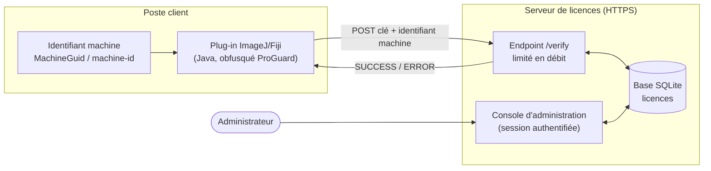
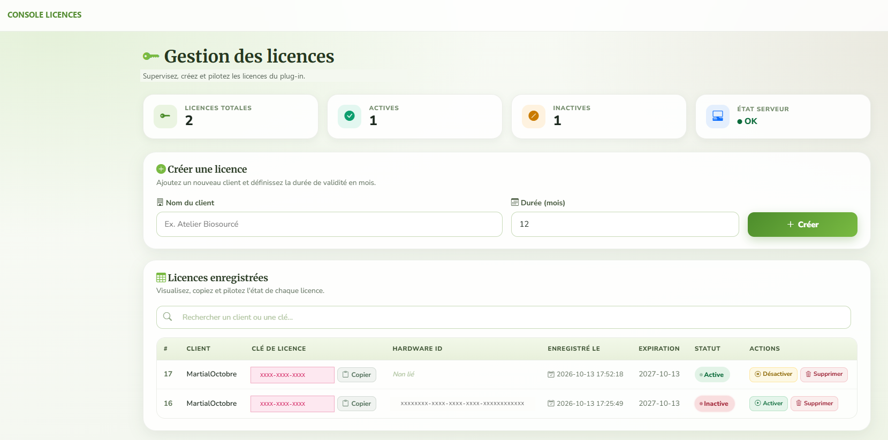
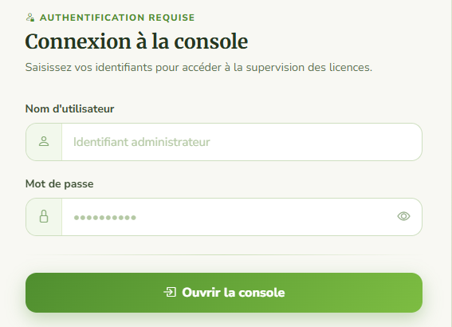
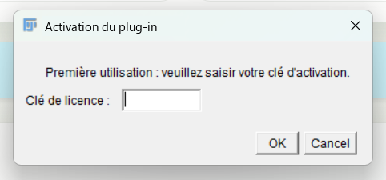

# Plugin Licensing — protection et licences d'un plug-in Java commercial

> Vitrine d'un projet réalisé en entreprise. Le code source, les binaires et la configuration de production restent privés : ils appartiennent à l'entreprise et protègent un logiciel vendu sous licence. Cette page présente la démarche, l'architecture et le résultat.

## Contexte

Une entreprise distribuait un plug-in scientifique d'analyse d'images pour **ImageJ/Fiji**, écrit en Java. Il circulait sans aucune protection : n'importe qui pouvait le copier, l'utiliser ou le décompiler, ce qui empêchait de le vendre.

**Ma mission :** rendre le plug-in commercialisable. Il fallait protéger le code, conditionner son utilisation à une licence valide et donner à l'entreprise un outil simple pour gérer ses clients.

## Solution

### 1. Protection du plug-in (Java)
- Contrôle d'accès exécuté **à chaque lancement**, avant toute analyse.
- Saisie de la clé à la première utilisation, puis mémorisation locale.
- **Liaison matérielle** : la clé est associée à l'identifiant unique du poste (`MachineGuid` sous Windows, `/etc/machine-id` sous Linux). Une clé ne peut donc pas être partagée entre plusieurs ordinateurs.
- **Obfuscation ProGuard** et script de build PowerShell qui automatise compilation, packaging `.jar` et obfuscation.
- Messages d'erreur explicites côté utilisateur : clé refusée, licence expirée ou désactivée, serveur injoignable.

### 2. Serveur de licences
- **Règles de validation** : clé inconnue, désactivée ou expirée → refus. À la première activation, la clé est liée à la machine. Ensuite, seule cette machine est acceptée.
- **Sécurité** :
  - limitation du nombre de requêtes sur l'endpoint de vérification ;
  - comparaison des identifiants en temps constant ;
  - console protégée par session ;
  - identifiants d'administration hors du code versionné.
- Deux implémentations : **PHP + SQLite** pour l'hébergement mutualisé de production, et une variante **Python Flask/WSGI**.

### 3. Console d'administration
- Tableau de bord : licences totales, actives, inactives, état du serveur.
- Création d'une licence en deux champs : nom du client et durée en mois.
- Recherche, copie de clé, activation, désactivation et suppression.

## Aperçu

| Console de gestion des licences |
|---|
|  |

| Connexion à la console | Activation dans le plug-in |
|---|---|
|  |  |

*Captures anonymisées : le nom de l'entreprise, du produit et les clés réelles ont été masqués.*

## Résultat

- Le plug-in est désormais **vendu sous licence**, ce qui génère des revenus pour l'entreprise.
- L'entreprise gère ses clients en autonomie depuis la console, sans intervention technique.
- J'ai rédigé un dossier de maintenance, un guide d'administration et une notice d'installation et d'activation bilingue (FR/EN) pour la reprise du projet.

## Stack technique

| Domaine | Technologies |
|---|---|
| Plug-in | Java, API ImageJ/Fiji, `HttpURLConnection` |
| Protection | ProGuard, liaison matérielle, build PowerShell |
| Serveur | PHP 8, Python 3 (Flask, Flask-Limiter, WSGI), SQLite |
| Interface | HTML/CSS, templates Jinja2 |
| Déploiement | Hébergement web mutualisé, HTTPS |

## Compétences mises en œuvre

Sécurité logicielle (obfuscation, licences, liaison matérielle) · Développement Java · API backend PHP et Python · Interface d'administration · Automatisation du build · Mise en production · Documentation technique.

## Pourquoi le code n'est pas public

Ce projet protège un produit commercial. Publier les sources, le `.jar` ou la configuration d'obfuscation permettrait de contourner la protection. Le code est disponible **sur demande pour un recruteur**, dans un cadre approprié et avec l'accord de l'entreprise.

---

*Projet réalisé par **Martial GADJEU**, stagiaire Data Engineer & AI (UTT, Troyes).*
